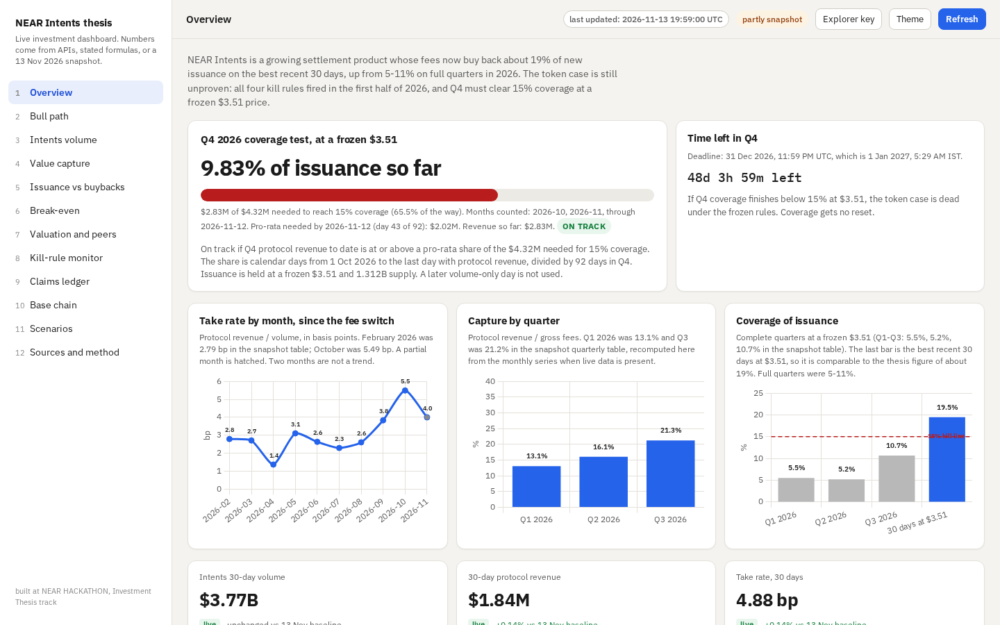

# NEAR Intents investment thesis dashboard

**Live dashboard:** https://near-intents-thesis-coral.vercel.app



**Bull case in one line:** Buybacks beat issuance only if HSP-029 is adopted (cutting the target by a third), the take rate is about 7 bp, and volume is about $10B a month, or $84M a year against about $74M of issuance at $3.51 (thesis, section 7).

built at NEAR HACKATHON, Investment Thesis track.

This is research, not investment advice.

## The thesis, in plain words

NEAR is now a bet on one product, Intents. Since 23 Feb 2026 a fee switch sends protocol revenue into buying NEAR on the open market. On the best recent 30 days that revenue covers about 19% of new issuance. Full quarters in 2026 covered 5-11%. All four of our quantitative kill rules fired in the first half of 2026. We restated the thesis as a fresh call from Q4 2026, with rules frozen on 14 Nov 2026. Coverage gets no reset: if Q4 2026 coverage is below 15% at a frozen $3.51 price, the token case is dead.

The dashboard makes three things obvious:

1. Is Intents volume growing, and in steps or smoothly?
2. How much of each fee dollar does the protocol keep, and is that share rising?
3. How far is protocol revenue from covering issuance, and what volume and take rate close the gap?

## Kill rules

Each of the first three fires after two complete quarters in a row past its level, counting from Q4 2026. Coverage gets no reset.

- Intents volume below $8B a quarter. FIRED on Q1-Q2 2026 ($7.18B, $6.25B). Q3 recovered to $9.79B.
- Capture below 20%. FIRED on Q1-Q2 (13.1%, 16.1%). Q3 reached 21.2%.
- Take rate below 3 bp. FIRED on Q1-Q2 (2.21 bp, 2.40 bp). Q3 reached 3.14 bp.
- Revenue / issuance below 15% at a frozen $3.51. FIRED, and still below (5.5%, 5.2%, 10.7% in Q1-Q3). Q4 is the last test.

Forward rules also kill on a quarter with volume up and revenue down, if HSP-029 is vetoed or not adopted within six months, on a loss of user funds in the Intents verifier or Chain Signatures, or if ex-HOT daily signers fall below 40K (provisional, unmeasured here).

## How to run

```
npm start
```

That runs `npx serve .`. Or open `index.html` in a browser. Serving it this way avoids some `file://` CORS limits on the public APIs.

The page is one self-contained HTML file. Chart.js is loaded from a CDN. No build step. Do not commit `node_modules/`.

## How to add the Explorer key

The NEAR Intents Explorer API needs a partner JWT. Click **Explorer key** in the top bar, paste the token, and choose **Use key**. The token is kept only in this tab's memory and is sent only to `explorer.near-intents.org`. It is never written to disk or to this repo.

Without a key, 1Click volume figures stay on the frozen 13 Nov 2026 snapshot and are tagged as such. The rest of the dashboard does not wait on this API.

## What refreshes, and what is live vs snapshot

The dashboard fetches on load, every 10 minutes, and when you click **Refresh**. Responses are cached for 10 minutes.

Live sources (no key):

- DefiLlama: Intents volume, gross fees, protocol revenue, holders revenue, and NEAR chain fees
- CoinGecko: NEAR price, market cap, circulating supply, and peer market caps (`simple/price` and `coins/near`). The dashboard does not call CoinGecko `market_chart`, which was returning HTTP 401.
- NEAR RPC: total supply and the on-chain max inflation rate

Snapshot, 13 Nov 2026, if a call fails or cannot run in the browser:

- The frozen baseline figures and monthly / quarterly tables in the dashboard brief
- 1Click Explorer totals, unless you enter a JWT
- Buyback wallet balance from revenue.near.org (the page marks those figures illustrative)
- Base-chain activity from Nansen and NearBlocks via CoinPaprika (secondary)

BigQuery is shown as "offline query, see repo". It is not callable from a browser. The SQL is in the Sources view.

A GitHub Action (`.github/workflows/snapshot.yml`) runs daily at 06:00 UTC, fetches the DefiLlama endpoints from the brief, and commits `data/snapshots/YYYY-MM-DD.json`. The full protocol-page payload is trimmed to the latest TVL point so the file stays small. You can also run `python scripts/fetch_snapshot.py` yourself.

Every number comes from a live API call, from a stated formula applied to live data, or from that snapshot, tagged with its date. Failed calls show the snapshot value, a visible "snapshot, 13 Nov 2026" tag, and the error. Nothing is invented, estimated or smoothed.

The Q4 2026 coverage test always uses the frozen $3.51 price, not the live price. An "on track" / "not on track" label compares Q4 revenue to a pro-rata share of the $4.32M needed, using calendar days to the last day with protocol revenue.

## Try it (for a judge or an AI)

1. Open the live dashboard. Within a few seconds the Overview should show a Q4 coverage headline, three trend charts (take rate, capture, coverage), six KPI tiles, and a last-updated time in the top bar.
2. Do: read the Q4 headline. See: progress toward 15% at $3.51, which months are counted, a countdown to 31 Dec 2026 11:59 PM UTC shown against 1 Jan 2027, 5:29 AM IST, and an on-track or not-on-track label with the pro-rata method stated.
3. Do: read the three trend charts, then the KPI tiles. See: monthly take rate since the fee switch, quarterly capture, and quarterly coverage plus a 30-day bar at $3.51.
4. Do: read the red box. See: four quantitative kill rules that fired in the first half of 2026.
5. Do: open Bull path. See: live progress bars for the 7 bp take-rate test and the $10B monthly volume test, a manual row for HSP-029, and the confirm-signal checklist.
6. Do: open Break-even. Move the price and take-rate sliders. See: the break-even monthly volume, its multiple of the $4.80B record, and the highlighted heatmap cell move together.
7. Do: open Kill-rule monitor. See: four history rows marked FIRED, and forward rules marked OK, WATCH or UNMEASURED. The Q4 coverage row uses $3.51.
8. Do: turn the network off and reload, or block the APIs. See: every view still renders from the 13 Nov 2026 snapshot, with snapshot tags, and the status pill reading offline.
9. Do: open Sources and method. See: a data-status panel listing each call, its result and its time, and no CoinGecko `market_chart` 401.

## Files

- `index.html` - the dashboard
- `near-intents-thesis.pdf` - the thesis report
- `dashboard-brief.pdf` - the build brief and acceptance checklist
- `LICENSE` - MIT, copyright Scala Field 2026
- `screenshots/` - 1440x900 captures of Overview, Bull path / Q4, and the kill-rule monitor
- `scripts/fetch_snapshot.py` and `.github/workflows/snapshot.yml` - daily DefiLlama snapshot
- `CHECKLIST.md` - Section 11 acceptance results

Repository: https://github.com/hialdu88/near-intents-thesis
